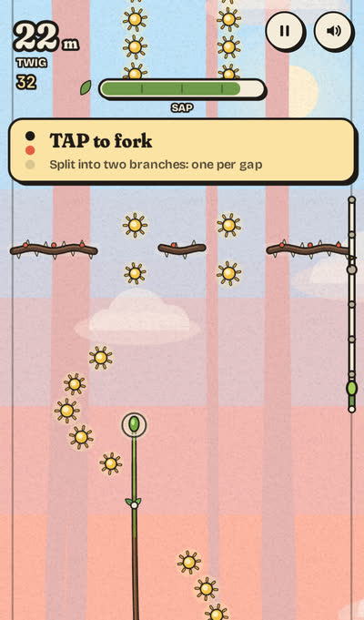
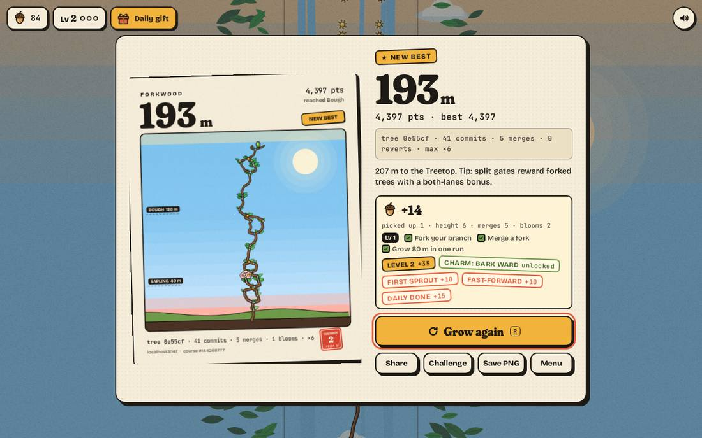
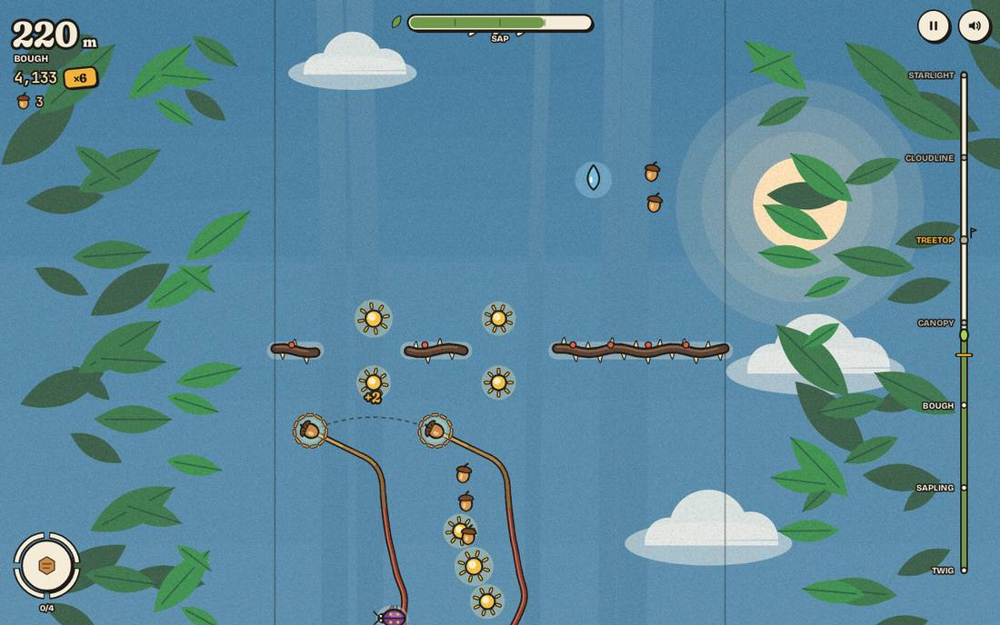
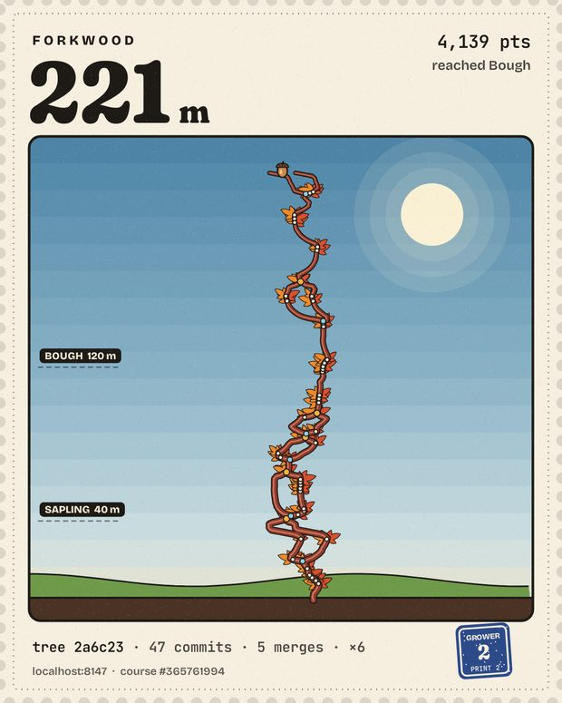
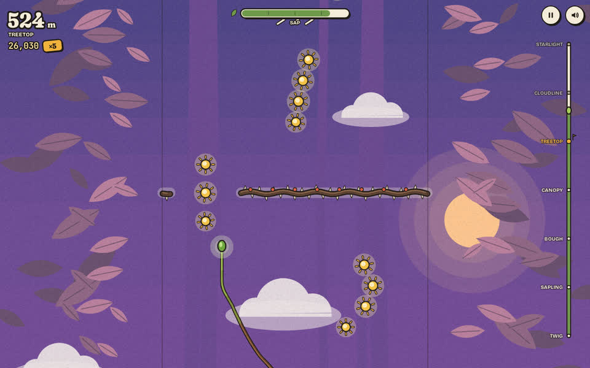

# Forkwood

**Grow a living branch from twig to treetop. Fork it in two, merge it back for combos, and don't get reverted.**

A one-touch browser game made for **Twigpine Project Treetop, Round 01 (Games)**, theme *"From twig to treetop"*.

▶ **Play:** https://ducvuathuduc.github.io/treetop-forkwood/ (no install, no account, desktop and phone)

| Golden hour at ×8 | Your tree as a postcard | On a phone |
|---|---|---|
|  |  |  |

## The idea in one breath

Your branch grows by itself and you steer it into sunlight. **Tap to fork** it into two tips that sweep twice the sky and slip through split gates. **Tap again to merge**: every sunlight both branches caught is cashed in at once and your multiplier climbs. Reach **×8** and **golden hour** begins: sunlight drifts to you and every point counts double. Catch a whole trail of sunlight and that part of the branch bursts into **full bloom**. Get hit while forked and that branch is **reverted**: it visibly rolls back to the fork point and its commits are gone. Climb from **Twig** to the **Treetop** at 400 m, then past the clouds to the stars.

It is version control you can feel: commits are leaves, forks and merges are real branch shapes, a revert un-grows wood, and every finished run gets a commit-style hash (`tree a1f3c9 · 128 commits · 7 merges`).

## How to play

| | Desktop | Phone |
|---|---|---|
| Steer the growing tip | mouse, or ← → / A D | drag anywhere (relative, so your thumb never covers the tip) |
| **Fork** / **merge** | click, or Space / ↑ | tap |
| Fire your charm (from level 2) | E or Shift | tap the charm badge, bottom left |
| Restart instantly | R | Grow again |
| Pause / mute | P or Esc / M | buttons, top right |

* The first run teaches itself in three steps (steer, fork, merge). Time slows down when it is waiting for your tap, so nobody misses the first fork.
* Your tip burns **sap**; sunlight refills it. Forking burns sap 1.4× faster, so a fork is a bet you cash in by merging.
* Beetles and thorn vines hurt. On a single tip a hit costs sap and resets your multiplier; on a fork it reverts that branch.
* Frost slows you, wind pushes you, dew refills sap, bark gives a one-hit shield.
* **Golden hour** (a merge that reaches ×8): 6 seconds of gold, slower sap drain, sunlight comes to you, double points. Afterwards the multiplier settles to ×4, so you can earn it again.
* **Full bloom**: catch every sunlight in a trail. Blossoms stay on your tree and on your postcard.
* The ladder on the right shows Twig → Sapling → Bough → Canopy → **Treetop** → Cloudline → Starlight, with your best height marked in gold.

## Reasons to play again

* **Challenge a friend:** every run's course comes from a seed. *Challenge* copies a link (`?seed=…&beat=…`) that gives your friend the exact same course with your height as the line to beat.
* **Daily tree:** everyone gets the same seeded course each UTC day, with its own best.
* **Postcard of your tree:** game over shows the whole tree you grew, blossoms and all, with height, score and its hash. Share it (Web Share, or copy/download the PNG).
* Local stats only (best height and score, runs, treetops reached). No accounts, no tracking, no network calls to anyone.

## Grow with it: acorns, levels, charms and skins

None of this gets in the way of the first run: a new player sees the same one-screen title and plays straight away. From the second run on, the tree starts to grow with you.

* **Acorns** are earned only by playing: pick them up in the sky, and every run pays for its height, merges, blooms and golden hours. Nothing is sold for money, there are no ads and no accounts.
* **Levels with three goals each**, written by hand for the first twelve levels (one that teaches, one that stretches, one you will do anyway), then generated. Finish all three to level up.
* **Daily and weekly challenges** (three each, the same for everyone on a given day) and a **daily gift** with a 7-day streak calendar. Every 7th day adds a frost guard that saves one missed day.
* **18 badges**, stamped like a printer's seal.
* **Charms**: take one into a run. Scoring merges charge it, and **E / Shift** or a tap on the charm badge fires it: *Bark Ward* (shield), *Sun Call* (sunlight drifts to you), *Deep Roots* (+25 sap, but combo −2) and *Stillness* (hazards slow down). Each is a small, measured edge (the bot measures +1% to +11% median height). **The daily tree and challenge links never use charms**, so those stay the same for everyone.
* **The shop**: 26 skins in six slots (bark, leaves, blossom, branch tip, sky plate, postcard), all drawn in the same woodblock style: birch bark with ink marks, needle, maple and ginkgo leaves, an acorn-cap or paper-lantern tip, a Prussian-blue or risograph sky, a perforated postage-stamp postcard. Skins never change the game. One item a day is 25% off.
* **Rings** (your profile): lifetime stats and your five tallest trees, stored only on your device.

## What is original here

* A growth game where the **shape of your tree is the record of how you played**: every fork, merge, bloom, hit and revert stays visible in the wood.
* **Fork/merge as a risk-reward combo system.** Forking doubles your reach and your exposure; merging banks it. Reverts are not just a penalty: you watch the branch un-grow.
* The whole thing is a **git metaphor that stays out of the way**. Players who have never used git just see a tree; players who have get the joke.

## Look, feel and sound

* **Art direction: a pressed-leaf woodblock print.** Every object you play with shares one warm ink outline; the backgrounds stay flat and soft, so gameplay always reads first. The sky is posterised into stepped colour bands that you climb through, with a paper grain on top. Everything is drawn in code, nothing is an image.
* **Type:** Fraunces for the big numbers and banners, Bricolage Grotesque for the interface, JetBrains Mono for scores and hashes.
* **Game feel:** trauma-based screen shake with smooth noise, hit-stop on hits, merges and golden hour, a camera punch that scales with the combo, sunlight that flies into the sap meter, a bud that squashes and stretches, numbers that pop in and shrink away, a seed that bursts out of the soil when you press Grow, and a slow-motion first fork.
* **Sound:** the music is generated live (an FM kalimba over a four-chord loop in each stage's key, with bass, soft drums and a generated reverb). It speeds up and thickens as you climb, closes in when your sap runs low and shimmers during golden hour. Effects layer synth tones over CC0 wooden foley from Kenney.
* **Signature moments:** the first frame is "pulled" like a fresh print (an ink roller lifts the paper off the scene), each new stage rolls its colour plate across the screen, and every postcard is printed in and sealed with your grower level and print number.
* **Calm mode** (title screen, on automatically with the system's reduce-motion setting) turns off shake, flashes, vibration and interface animation.

## Tech notes

* Vanilla JavaScript (ES modules), one `<canvas>`, no framework, no build step, no third-party requests. First load is about 340 KB uncompressed including fonts and sound.
* One small library: [ZzFX](https://github.com/KilledByAPixel/ZzFX) (MIT) renders the short menu and charm sounds. It is vendored in `src/vendor/` and only loaded after your first tap. Bigger engines (PixiJS, Phaser, Howler, GSAP, Matter.js, Lottie) were considered and left out: the game already runs at 60 fps in Canvas 2D, and they would have multiplied the load size or broken the deterministic simulation.
* Progress lives in one `localStorage` save (`src/meta.js`), with an automatic upgrade from the first public build's save (your best, runs and settings carry over, plus acorns for the metres you already grew).
* Runs at 60 fps in headless Chromium at 1280×800 and on phone viewports, with about 1.5 ms of JavaScript per frame.
* Deterministic simulation (`src/sim.js`) shared by the game and a **headless auto-playtest bot** (`src/bot.js`), used to tune difficulty: over 120 seeded runs per skill level, a weak bot's median run is about 54 s and an expert's about 106 s (`npm run balance`).
* `tests/fairness.mjs` generates 300 seeded courses to 1,200 m and checks that every gap fits, every split gate fits a forked pair, and every gate is reachable from the one before it.
* `tests/tutorial.mjs` plays the first-run coach through the real game loop on desktop and two phone sizes and checks that the coach card and stage banners never overlap.
* `tests/smoke.mjs` plays the game in headless Chromium with a real mouse, touch drags and taps, checks challenge links, and fails on any console error.
* `tests/meta.mjs` checks the progression rules without a browser: save upgrade and repair, gifts and streaks, shop rules, challenges and badges, that charms never touch pure runs or the course, the charm balance band, and economy pacing with the real simulation and bot.
* `tests/meta-ui.mjs` plays the meta layer in headless Chromium: first visit untouched, rewards after a real run, gift, buying and wearing skins, charms in play (and off on the daily tree), persistence across reloads, the old-save upgrade, a corrupt save, phone layouts, frame time and console errors.
* `tests/extra.mjs` checks reduced motion (calm mode, no shake), that a tap on a phone unlocks audio and decodes the sound sprite, the payload budget, and that nothing is requested from another origin.

## Run locally

```bash
python3 -m http.server 8080   # then open http://localhost:8080
npm run balance               # bot difficulty report (Node 18+)
npm run fairness              # course fairness check
npm run tutorial              # first-run coach test (needs Playwright + Chromium)
npm run smoke                 # browser smoke test (needs Playwright + Chromium)
npm run extra                 # reduced motion, audio unlock, payload, origins
npm run meta                  # progression rules + economy pacing (Node 18+)
npm run meta-ui               # meta layer in the browser (needs Playwright + Chromium)
```

## Progress screens

| Shop: skins drawn in the print style | Goals, gift streak and challenges | Rewards after a run |
|---|---|---|
|  |  |  |

| Skins in play: cherry bark, maple leaves, acorn tip, Prussian-blue sky | Postage-stamp postcard with the grower's seal |
|---|---|
|  |  |

## More screenshots

| Title | Fork through a split gate | Game over |
|---|---|---|
|  |  |  |

## Built during the round

Built from scratch during **9–16 October 2026** for the round; the commit history shows the build. Made with AI assistance, as the round rules allow.

## Credits

Design, code, procedural art and generative music: Huynh Dieu Thanh ([@thanhdicode](https://github.com/thanhdicode)) with AI assistance.
Fonts: Fraunces, Bricolage Grotesque and JetBrains Mono (SIL Open Font License 1.1). Sound effects: Kenney's Impact Sounds and Interface Sounds (CC0). Full list with sources and licence files in [CREDITS.md](CREDITS.md). No third-party characters, logos or brands.

## License

Code: MIT, see [LICENSE](LICENSE). Fonts keep their OFL licence and the Kenney sounds are CC0, as listed in [CREDITS.md](CREDITS.md).
