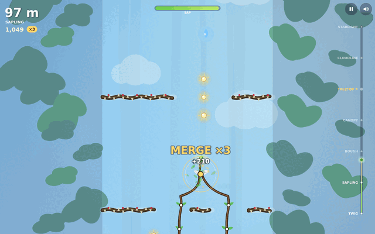
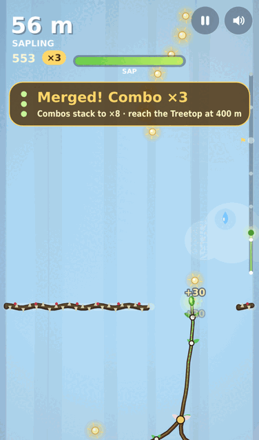
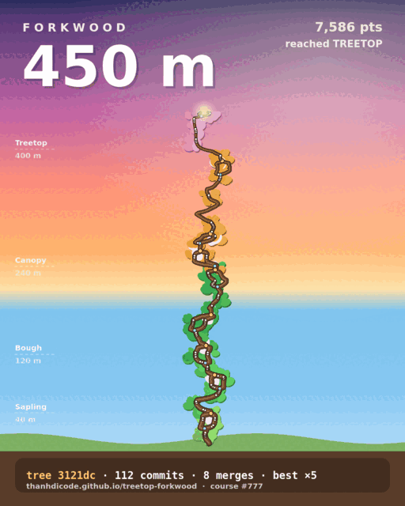

# Forkwood

**Grow a living branch from twig to treetop. Fork it in two, merge it back for combos, and don't get reverted.**

A one-touch browser game made for **Twigpine Project Treetop, Round 01 (Games)**, theme *"From twig to treetop"*.

▶ **Play:** https://ducvuathuduc.github.io/treetop-forkwood/ (no install, no account, desktop and mobile)

| Desktop, mid-run at combo ×3 | Phone | Your tree as a postcard |
|---|---|---|
|  |  |  |

## The idea in one breath

Your branch grows by itself. You steer it into sunlight. **Tap to fork** it into two tips that sweep twice the sky and slip through split gates. **Tap again to merge** them, and every sunlight each branch caught is cashed in at once and your multiplier climbs (up to ×8). Get hit while forked and that branch is **reverted**: it visibly rolls back to the fork point and its commits are gone. Climb from **Twig** to the **Treetop** at 400 m, then keep going past the clouds to the stars.

It is version control you can feel: commits are leaves, forks and merges are real branch shapes, a revert un-grows wood, and every finished run gets a commit-style hash (`tree a1f3c9 · 128 commits · 7 merges`).

## How to play

| | Desktop | Phone |
|---|---|---|
| Steer the growing tip | mouse, or ← → / A D | drag anywhere (relative, so your thumb never covers the tip) |
| **Fork** / **merge** | click, or Space / ↑ | tap |
| Restart instantly | R | Grow again |
| Pause / mute | P or Esc / M | buttons, top right |

* The first run teaches itself in three steps (steer, fork, merge). Time slows down when it is waiting for your tap, so nobody misses the first fork.
* Your tip burns **sap**. Sunlight refills it. Forking burns sap 1.4× faster, so a fork is a bet you cash in by merging.
* Beetles and thorn vines hurt. On a single tip a hit costs sap and resets your multiplier; on a fork it reverts that branch.
* Frost slows you, wind pushes you, dew refills sap, bark gives a one-hit shield.
* The ladder on the right shows Twig → Sapling → Bough → Canopy → **Treetop ⚑** → Cloudline → Starlight, with your best height marked in gold.

## Reasons to play again

* **Challenge a friend:** every run's course comes from a seed. *Challenge* copies a link (`?seed=…&beat=…`) that gives your friend the exact same course with your height as the line to beat.
* **Daily tree:** everyone gets the same seeded course each UTC day, with its own best.
* **Postcard of your tree:** game over shows the whole tree you grew, with height, score and its hash. Share it (Web Share, or copy/download the PNG).
* Local stats only (best height and score, runs, treetops reached). No accounts, no tracking, no network calls.

## What is original here

* A growth game where the **shape of your tree is the record of how you played**: every fork, merge, hit and revert stays visible in the wood.
* **Fork/merge as a risk-reward combo system.** Forking doubles your reach and your exposure; merging banks it. Reverts are not just a penalty, you watch the branch un-grow.
* The whole thing is a **git metaphor that stays out of the way**. Players who have never used git just see a tree; players who have get the joke.

## Tech notes

* Vanilla JavaScript (ES modules), one `<canvas>`, no framework, no build step, no runtime network requests. The game code is about 125 KB uncompressed.
* **All graphics are procedural** (canvas paths and gradients) and **all audio is synthesised** with WebAudio: a generative pentatonic score whose layers and tempo rise as you climb, plus synth sound effects whose pitch climbs with your sunlight chain. No image, font or sound files in the game itself.
* Game feel: hit-stop on hits and merges, screen shake, camera punch, particles, vibration on Android phones. **Calm mode** (on the title screen, and on automatically with the system's reduce-motion setting) turns off shake, flashes and vibration.
* Deterministic simulation (`src/sim.js`) shared by the game and a **headless auto-playtest bot** (`src/bot.js`), which was used to tune difficulty: over 120 seeded runs per skill level, a weak bot's median run is about 57 s and an expert's about 104 s (`npm run balance`).
* `tests/fairness.mjs` generates 300 seeded courses to 1,200 m and checks that every gap fits, every split gate fits a forked pair, and every gate is reachable from the one before it.
* `tests/tutorial.mjs` plays the first-run coach through the real game loop on desktop and two phone sizes and checks that the coach card and stage banners never overlap.
* `tests/smoke.mjs` loads the game in headless Chromium, plays it with a real mouse, relative touch drags and taps, checks challenge links, and fails on any console error.

## Run locally

```bash
python3 -m http.server 8080   # then open http://localhost:8080
npm run balance               # bot difficulty report (Node 18+)
npm run fairness              # course fairness check
npm run tutorial              # first-run coach test (needs Playwright + Chromium)
npm run smoke                 # browser smoke test (needs Playwright + Chromium)
```

## Built during the round

Built from scratch during **9–16 October 2026** for the round; the commit history shows the build. Made with AI assistance, as the round rules allow.

## Credits

Design, code, procedural art and synthesised audio: Huynh Dieu Thanh ([@thanhdicode](https://github.com/thanhdicode)) with AI assistance.
No third-party characters, logos, brands or assets. Playwright is used only for local testing and is not shipped.

## License

MIT, see [LICENSE](LICENSE).
