# Forkwood

**A one-touch tree that grows from your choices. Fork it in two, merge it back for combos, and climb from twig to treetop.**

<p>
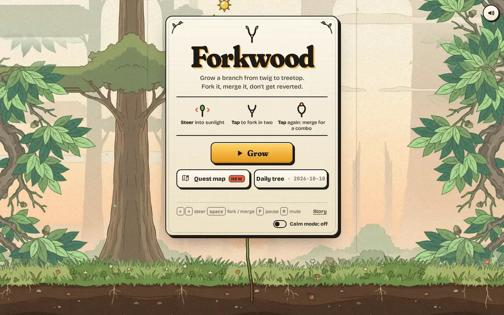
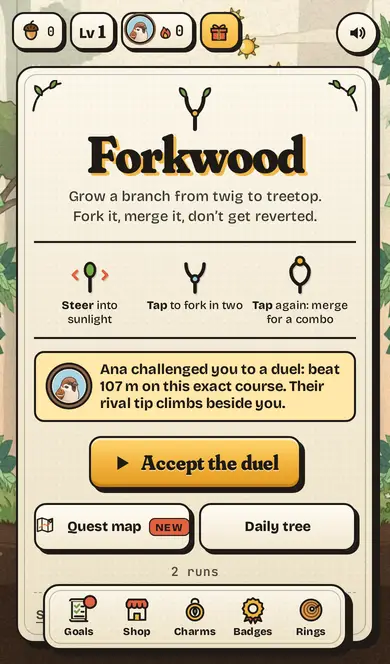
</p>

▶ **Play now in your browser:** https://ducvuathuduc.github.io/treetop-forkwood/
No install, no account, no ads. Desktop and phone. Made for **Twigpine Project Treetop, Round 01 (Games)**, theme *"From twig to treetop"*.

## Why it is fun

Your branch grows by itself; you steer it into sunlight. **Tap to fork** it into two tips that sweep twice the sky and slip through split gates. **Tap again to merge** and everything both branches caught is banked at once, raising your combo. Get hit while forked and that branch is **reverted**: you watch it un-grow back to the fork. It is version control you can feel, and the tree you end with is the record of how you played.

* **One input, real decisions.** Every fork doubles your reach and your risk; every merge is a bet you cash in.
* **Short, readable runs.** A weak player lasts about a minute; experts fight for the stars.
* **Your tree as a postcard.** Every run ends with a printed card of the whole tree, its height, score and commit hash.

## What's new in 1.0

| Manga intro | Seven maps | Crow attack |
|---|---|---|
| 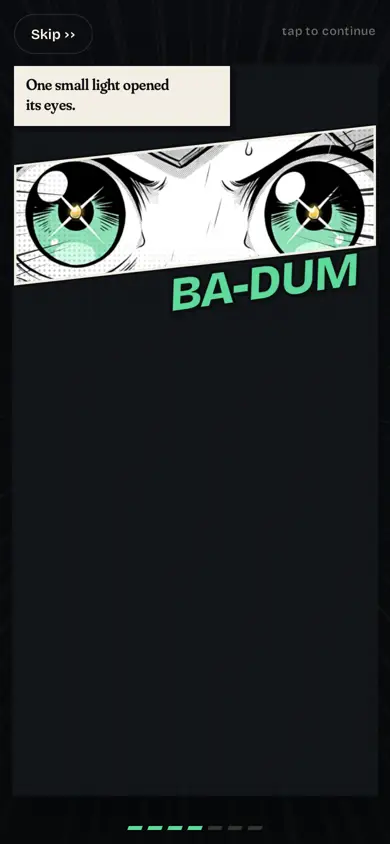 | 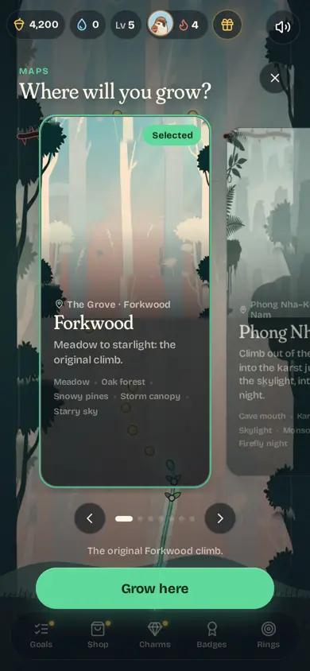 | 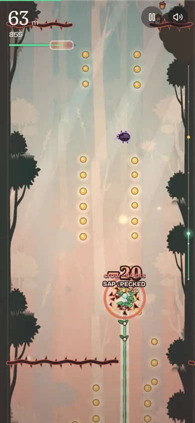 |

* **A manga intro.** Your first launch opens on an eight-panel manga: a storm, a crow that steals the light, and one sprout that decides to bring it back. Panels slam in, the page shakes on impact, and the last page breaks out of its frame into your first run. Under 30 seconds, Skip any time, replay it from the title.
* **Seven maps to grow in.** Forkwood, **Phong Nha Caves** (Việt Nam) and five more to unlock with acorns: **Arashiyama Bamboo** (Kyoto), **Redwood Giants** (California), **Black Forest** (Hansel & Gretel), **Amazon Canopy** and **Beanstalk Sky** (Jack and the Beanstalk). Each has its own painted plates, day-to-night palette, zone names and weather, and stamps its own postage stamp on your game-over postcard.
* **An endless-runner economy, earned only by playing** (no money anywhere): acorns plus rare **dew gems**; **boosts**, **upgrades** that make power-ups last longer, **seed pods** with their odds published in full, a **second chance** for 1, 2, 4, 8 gems, a daily **word hunt** (gold letter tiles in the tree) and a **grower multiplier**. Maps (900-2,400 acorns) and 20 new map-themed skins (filter the shop by map) are the big things to save for. All of it is off on the daily and weekly trees, quest levels, challenge links and races. Numbers and a 30-day simulation of casual, average and hardcore players: [ECONOMY.md](ECONOMY.md).
* **Traps you can feel.** Every trap warns you about 1.2 s ahead and lands with real impact: hit-stop, a coral burst, sap draining into the meter, damage numbers; near misses get a mint swoosh. The crow always dives on a marked lane: swerve out or fork round it, or lose sap, staged sunlight and 5% of your points ([TRAP-EVENTS.md](TRAP-EVENTS.md)).
* **Harder, fairer.** On Oak the bots last about 33 s (weak), 57 s (average) and 85 s (expert); Ancient is brutal. 300 seeded courses checked, 0 fairness problems.
* Still under 700 KB on first load: the story, the map art, the carousel, the race and the shop sections load only when you open them.

## What's new in 0.8.0

* **A calmer world.** The painted plates behind the play band are replaced by a quiet procedural woodblock backdrop that changes by height (meadow, oak, canopy, clouds, stars), with side art on wide screens, a zone bar, and a **record flag** planted on the trunk at your best height. Before and after: [before](screenshots/before-after/bg-before.webp), [after](screenshots/before-after/bg-after.webp).
* **9 telegraphed traps:** cracked twig, pulse thorns, trapdoor gate, crosswind, sap drain, golden lure, twin beetles, rising thorns and the crow. Each one warns you at least 0.8 s before it can hurt, comes in a gentle intro version the first time you meet it, and after 45 s they start arriving in combos. Close calls trigger a short slow-mo, and sap drain was retuned (quest levels keep their old drain).
* **A quiet difficulty director** in free play only: from your last 5 runs it moves pacing by at most ±15% (rest glades, how soon harder chunks come). It is off for daily, weekly, quest levels, challenge and duel links, and live races.
* **Seasons on your local clock:** Firefly Night, Golden Dawn, Autumn Maple, Winter Snow, Tết and the Weekend Twin Storm, shown as cards on the title with a countdown. They recolour the backdrop everywhere, but their gameplay modifiers only apply in free play; daily, weekly, quest, challenge, duel and race runs stay the same for everyone.
* **Live race** with a friend (below).

### Live race

Tap **Live** on the title card (next to Daily tree). You get a link (`?race=forkwood-<code>-<random>`); when your friend opens it you both land in a lobby, tap Ready, count down 3-2-1 and grow the **same 90-second tree** at the same time. Each of you sees the other's branch climbing as a dashed ghost with their name, plus a height bar at the bottom. When both trees are done the finish card names the winner (height, then points) and offers a rematch on a fresh course. Connections are peer-to-peer over WebRTC using [PeerJS](https://peerjs.com/) 1.5.5 and its free public broker; the library loads only when you start or join a race. If the connection cannot be made within about 8 seconds (or your friend drops), you can play the same course as an ordinary duel link instead. No accounts, nothing stored on a server. `npm run race` tests it with two browsers.

## What's new in v0.7: the Grove update

| Story intro (v0.7) | Painted world (dusk, 550 m) | Practice league |
|---|---|---|
|  | 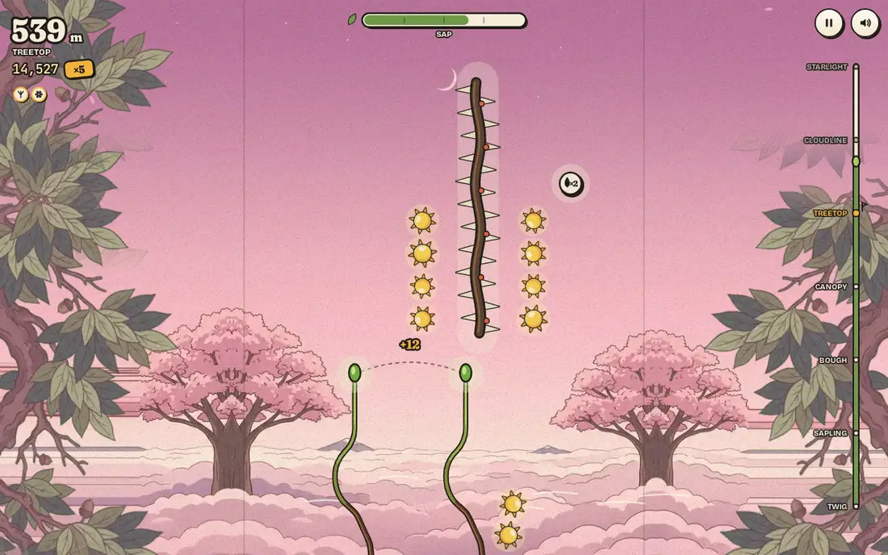 | 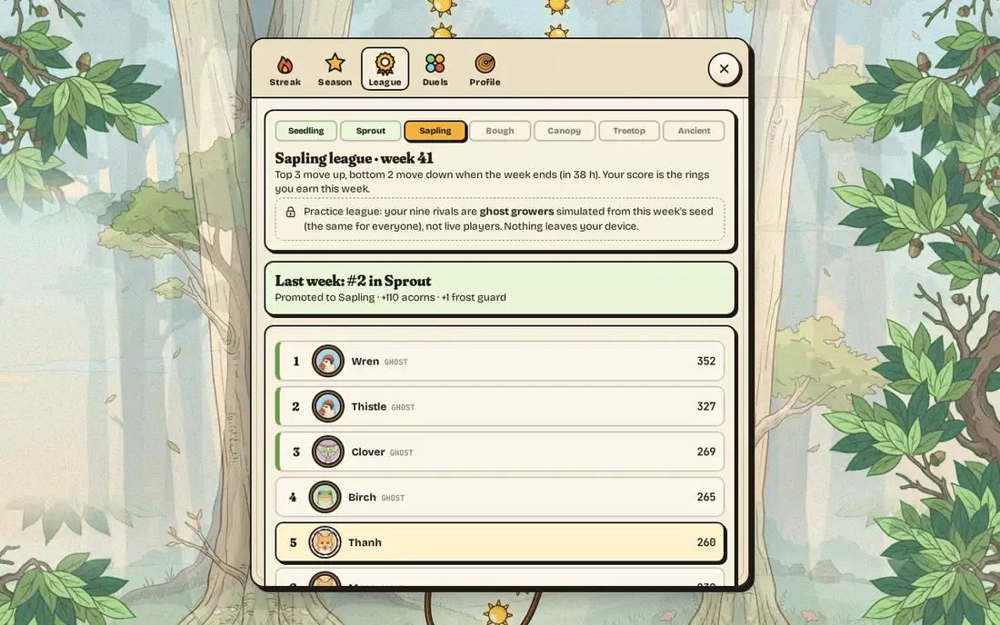 |

* **A story before your first run** (replaced by the manga intro in 1.0). Illustrated storybook plates told how a storm reverted the Great Tree and a sparrow saved one seed. Then the game drops you straight into your first tree, no menu in between. Replay it any time from the title (Story) or your profile.
* **A painted world.** Every stage now has its own illustrated backdrop in the woodblock style (dawn meadow, sunlit forest, amber canopy, dusk above the clouds, starlight), drifting with the climb and cross-fading between stages, with painted boughs framing the playfield on wide screens, a painted meadow and soil, and illustrated thorn vines, beetles and sun tokens. Buttons and cards got a finished edition look. Before and after: [desktop play](screenshots/before-after/desktop-play.webp), [title](screenshots/before-after/desktop-title.webp), [late game](screenshots/before-after/desktop-late.webp), [phone play](screenshots/before-after/phone-play.webp), [phone title](screenshots/before-after/phone-title.webp).
* **The Grove** (tap your portrait, top left):
  * **Streak** with milestones at 3, 7, 14, 30, 60 and 100 days, up to two frost guards that each save a missed day, and a 28-day calendar. Finishing a run counts; so does the daily gift.
  * **Grove season**: a free 30-tier track each month, earned only by playing (rings from height, goals, challenges and your first run of the day). New trails, portraits, frames, a Sakura leaf, a Lotus blossom and Mossy oak bark.
  * **Practice league**: Seedling → Sprout → Sapling → Bough → Canopy → Treetop → Ancient. Each week you race nine **ghost growers** generated from the week's seed (the same for everyone, and labelled as simulated, never as live players). Top 3 move up, bottom 2 move down.
  * **Duels**: tap **Duel** on any endless or daily result. Your friend opens the link, grows the exact same course and races your **rival tip**, which climbs at your average pace. They send their answer back and both of you collect acorns on your own device. No server, no account.
  * **Profile**: a critter portrait (sparrow, squirrel, owl, fox, snail, moth, frog, beetle), a frame, a badge and a name for your duels. Plus a new **Trail** slot for your tree (pollen, petals, fireflies, ink, stardust and more).
  * **Welcome back gifts** after three or more days away.

| Season track | Streak | Profile |
|---|---|---|
| 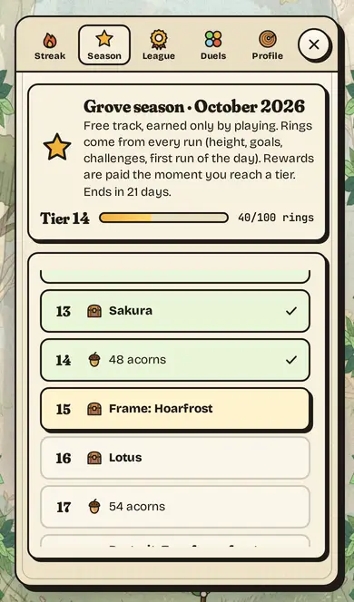 | 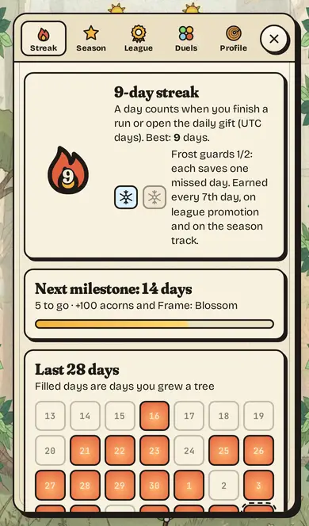 | 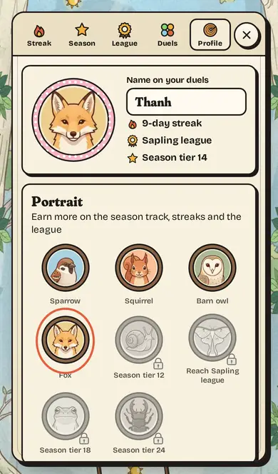 |

## The Quest update (v0.6)

| Quest map | Modes and stakes | A storm level |
|---|---|---|
| 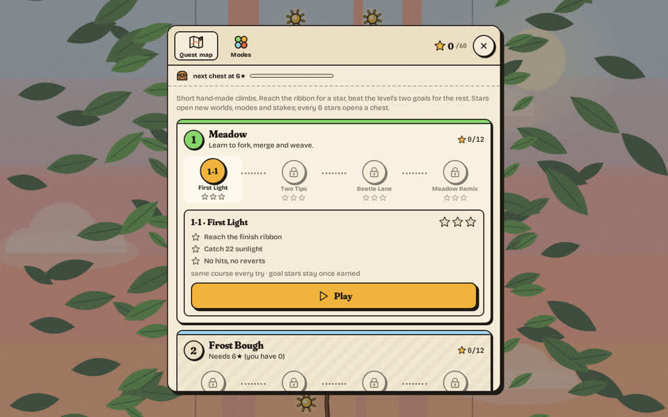 | 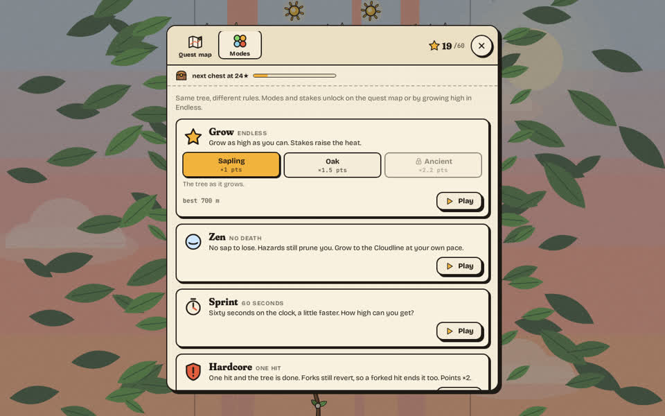 | 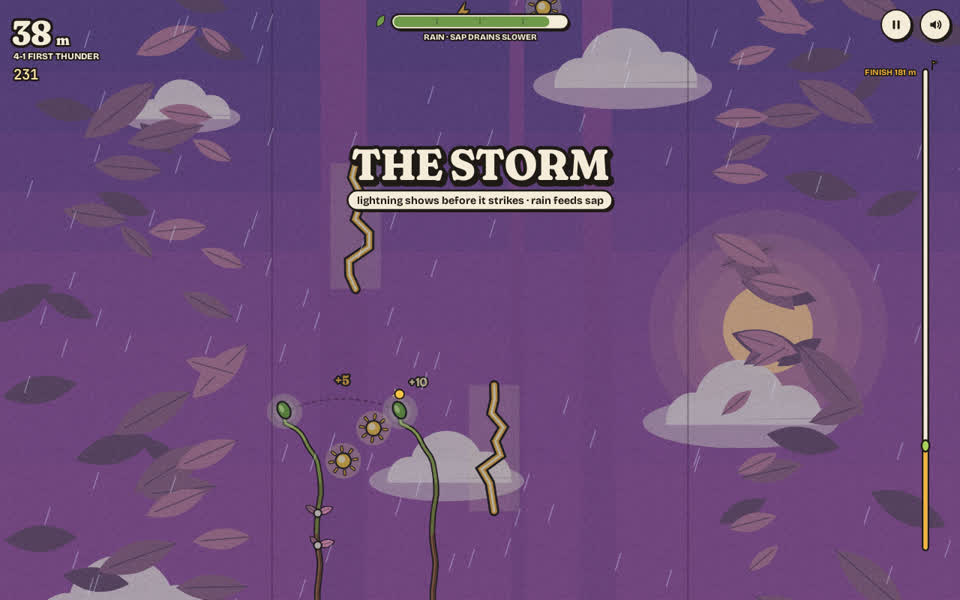 |

* **Quest map: 5 worlds, 20 hand-made levels, 60 stars.** Meadow teaches; Frost Bough slows you; Windy Canopy pushes you around thorn columns; Storm Crown throws lightning; Starlight throws everything. Each level is a short, fixed course (the same every try) with a finish ribbon and two goals of its own, such as "no hits", "merge 4 times" or "finish in 29 s". Goal stars stay once earned. The last level of each world is a harder remix.
* **Stakes: Sapling ×1, Oak ×1.5, Ancient ×2.2.** Each stake keeps the rules below it and adds its own: hazards sooner, thirstier sap, faster beetles, harder hits, fewer rest glades. Reach the Treetop on one stake to open the next.
* **Six modes**, each a different question:
  * **Zen**: no sap to lose. Grow to the Cloudline at your own pace.
  * **Sprint**: sixty seconds on the clock. How high can you get?
  * **Hardcore**: one hit and the tree is done. Points ×2.
  * **Looking-glass**: your steering is mirrored. Points ×1.5.
  * **Storm Rush**: storm after storm from 60 m up, each longer than the last.
  * **Weekly tree**: one course for everyone all week, on Oak, with a share code like `FW-2026W41`.
* **Rewards you earn, never buy:** a chest every 6 stars, 8 quest-only skins (Dandelion, Hoarfrost, Red cedar, Storm print, Aurora, Ember cap, Swift maple, Starwood) and 10 titles that print on your postcard.
* **A harder climb.** After the first minute the endless run tightens: hazards reach full strength by about 475 m instead of 620 m, sap drains faster from 280 m on, and three new late combos mix two biome ideas at once.
* **Share and challenge.** Every result has a challenge link: the same course (`?seed=…&beat=…`), the same quest level (`?lvl=2-3&beat=…`) or the same weekly tree (`?week=2026-W41&beat=…`). Level shares come with a spoiler-free star grid:

```
Forkwood quest 23/60★
1 ★★★ ★★★ ★★★ ★★☆
2 ★★★ ★★☆ ★★☆ ★☆☆
3 ★☆☆ ☆☆☆ ☆☆☆ ☆☆☆
4 · locked
5 · locked
```

## How to play

| | Desktop | Phone |
|---|---|---|
| Steer the growing tip | mouse, or ← → / A D | drag anywhere (relative, so your thumb never covers the tip) |
| **Fork** / **merge** | click, or Space / ↑ | tap |
| Fire your charm (from level 2) | E or Shift | tap the charm badge, bottom left |
| Restart | R | Grow again / Retry |
| Pause / mute | P or Esc / M | buttons, top right |

* The first run teaches itself in three steps (steer, fork, merge), slowing time while it waits for your first tap.
* Your tip burns **sap**; sunlight refills it. Forking burns sap faster, so merge to bank what you caught.
* Beetles and thorns hurt. On one tip a hit costs sap and your combo; on a fork it reverts that branch.
* **Every stage adds one thing:** frost and zig-zags (Bough), gusts and thorn columns you can straddle with a fork (Canopy), the **storm** with telegraphed lightning (Treetop), sliding thorns (Cloudline), and all of it under the stars.
* **Power-ups** (Pollen, Ink ×2, Sap Rush), **grafts** with a boon and a cost (fork to take both), graze chains, just-in-time merges, **golden hour** at ×8 and **full bloom** when you catch a whole trail.

## Modes at a glance

| Mode | Rule | Unlock |
|---|---|---|
| Grow (Endless) | climb as high as you can; pick a stake | from the start |
| Zen | no sap loss, finish at 600 m, points ×0.5 | clear level 1-2, or play 3 runs |
| Sprint | 60 s clock, growth ×1.12 | clear World 1, or grow 240 m |
| Hardcore | any hit ends the run, points ×2 | clear World 2, or reach 400 m |
| Looking-glass | mirrored steering, points ×1.5 | clear World 3, or grow 600 m |
| Storm Rush | 8 storms from 60 m, thornier ground, points ×1.6 | clear World 4, or Treetop on Oak |
| Weekly tree | same course for all week, Oak, no charms | 12 stars, or grow 850 m |
| Daily tree | same course for all today, no charms | from the start |

## Grow with it

Acorns come only from playing (pick-ups, height, merges, blooms, chests, the season, the league and duels). They buy cosmetic skins in seven slots, all drawn in the woodblock style; skins never change the game. There are levels with three goals each, daily and weekly challenges, a daily gift with a streak, 21 badges and four charms (small, measured edges that the daily tree, weekly tree, quest levels and challenge links switch off so they stay fair). Progress is saved only on your device.

## Difficulty, measured

The game shares one deterministic simulation with a headless auto-play bot, so balance is measured, not guessed. Median survival over 60 seeded runs per cell (`npm run stakes`):

| Bot | Sapling | Oak | Ancient |
|---|---|---|---|
| weak (0.3) | 60 s · 335 m | 51 s · 290 m | 37 s · 211 m |
| average (0.6) | 75 s · 464 m | 70 s · 422 m | 50 s · 308 m |
| expert (0.95) | 110 s · 770 m | 98 s · 658 m | 70 s · 466 m |

Every quest level is beaten by the expert bot and all 60 stars are reachable (`npm run quest`); the final level, *Starlight Remix*, is cleared by the expert bot in about 1 run in 6.

## Look, feel and sound

* **A pressed-leaf woodblock print.** Painted backdrops for every stage, one warm ink outline on everything you play with, paper grain. The tree, its leaves, blossoms, skins and effects are drawn in code; the painted plates, story plates, portraits and three sprites are images made for Forkwood (see CREDITS.md).
* **Game feel:** smooth-noise screen shake, hit-stop, a camera punch that grows with the combo, squash and stretch, a slow-motion first fork, a print-pull intro, stage colour plates, stamped rewards.
* **Sound:** music generated live (FM kalimba, bass and soft drums that speed up as you climb), plus CC0 wooden foley.
* **Calm mode** turns off shake, flashes, vibration and interface motion (on automatically with reduced motion).

## Tech

* Vanilla JavaScript (ES modules), one `<canvas>`, no framework, no build step, **no third-party requests**. First load about 645 KB uncompressed (fonts, sound and about 170 KB of painted art included); the other stage plates load as you climb toward them, and the story, quest map and Grove load only when opened.
* 60 fps on desktop and phone viewports in headless Chromium, about 2–5 ms of JavaScript per frame; images are decoded off the main thread before they are first drawn.
* `src/sim.js` is pure and deterministic: modes, stakes and quest levels are the same simulation with a few rules changed (`src/modes.js`, `src/campaign.js`); quest progress, unlocks, chests and titles are pure functions in `src/quest.js`.
* One small library: [ZzFX](https://github.com/KilledByAPixel/ZzFX) (MIT), vendored and loaded after your first tap.
* Saves live in one `localStorage` key with automatic upgrade and repair; saves from earlier builds keep their progress, and returning growers find modes and stakes already open for the heights they reached.

## Run locally

```bash
python3 -m http.server 8080   # then open http://localhost:8080
npm run quest                 # every level beatable + 3 stars reachable, mode rules, unlocks, saves (Node 18+)
npm run stakes                # survival per stake and mode with three bots
npm run fairness              # 300 seeded courses: every gap fits, every gate reachable
npm run chunks                # course director, power-ups, grafts, storms
npm run meta                  # progression rules and economy pacing
npm run retention             # streak, season, league ghosts, comeback, duel links, save migration
npm run intro                 # first-launch story, returning players, Grove, a duel between two devices
npm run quest-ui              # quest map, levels, modes, phone layouts in headless Chromium
npm test                      # everything (browser tests need Playwright + Chromium)
```

## More screenshots

| On a phone | Golden hour at ×8 | The postcard |
|---|---|---|
| 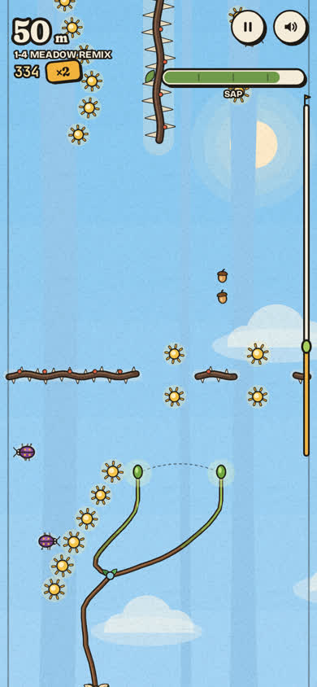 | 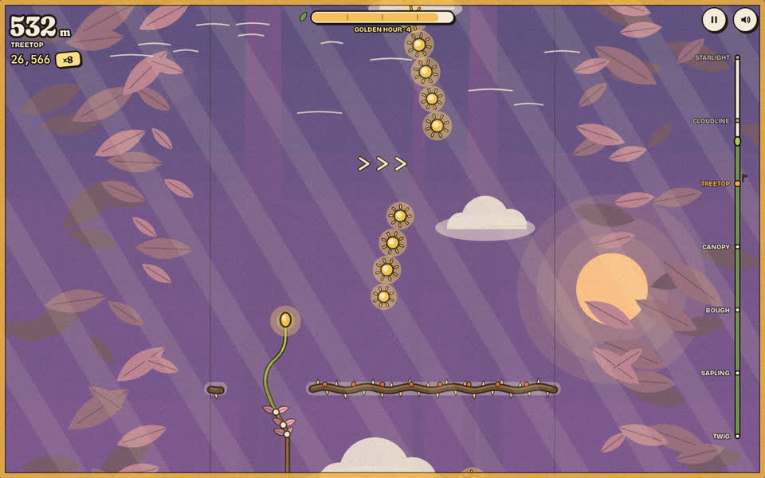 | 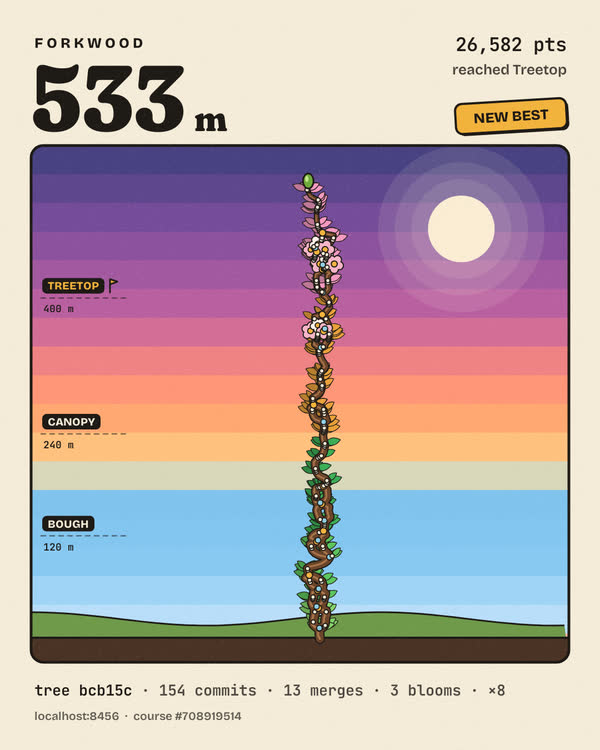 |

| Shop | Goals and gift streak | Title |
|---|---|---|
| 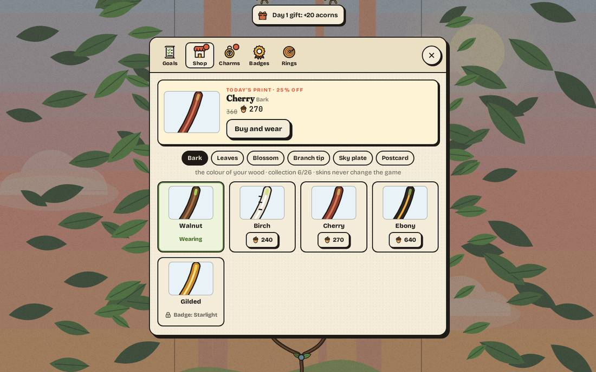 | 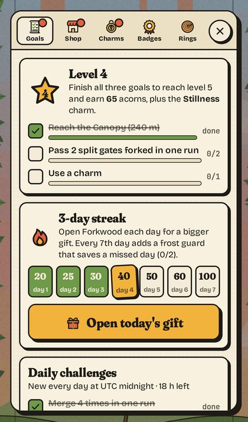 | 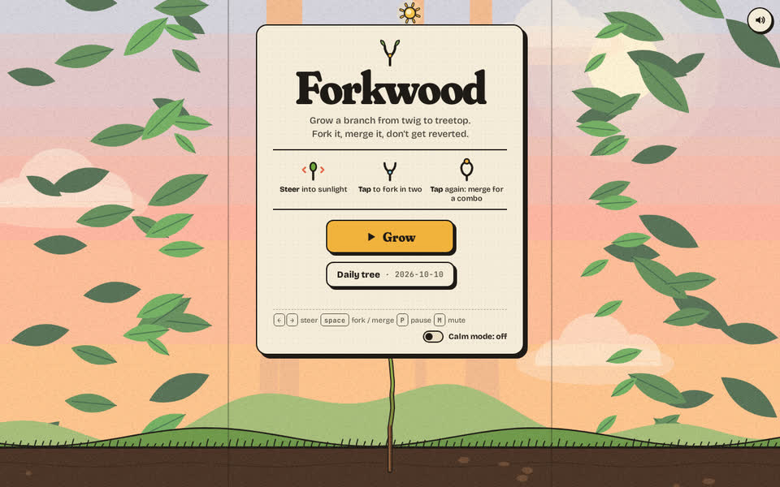 |

## Built during the round

Built from scratch during **9–16 October 2026** for the round; the commit history shows the build. Made with AI assistance, as the round rules allow.

## Credits and license

Design, code, procedural art and generative music: Huynh Dieu Thanh ([@thanhdicode](https://github.com/thanhdicode)) with AI assistance.
Fonts: Fraunces, Bricolage Grotesque and JetBrains Mono (SIL Open Font License 1.1). Sound effects: Kenney's Impact Sounds and Interface Sounds (CC0). Sources and licence files in [CREDITS.md](CREDITS.md). No third-party characters, logos or brands.

Code: MIT, see [LICENSE](LICENSE). Fonts keep their OFL licence; the Kenney sounds are CC0.
