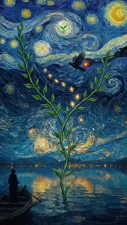
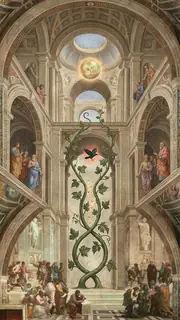
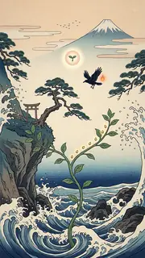
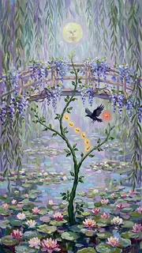
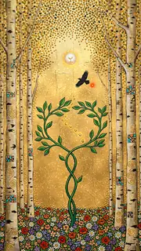
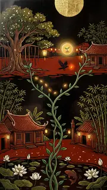
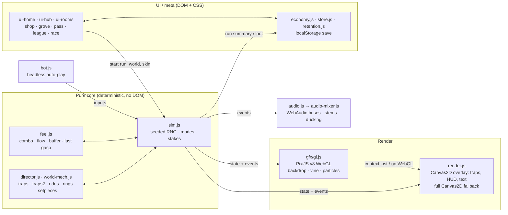

<div align="center">


# Forkwood

### Grow a vine through living masterpieces.

A one-touch browser game: **fork** your vine in two, **merge** it back for combos, and climb through seven painted worlds, from twig to treetop.

[](https://ducvuathuduc.github.io/treetop-forkwood/)
[](LICENSE)
[](https://pixijs.com/)
[](#architecture)
[](#performance-budgets)
[-lightgrey?style=flat-square)](#getting-started)

<br>



<sub>The seven worlds, as their in-game gallery paintings.</sub>

<br><br>

**[▶ Play now](https://ducvuathuduc.github.io/treetop-forkwood/)** · **[2.0 preview](https://ducvuathuduc.github.io/treetop-forkwood/v2/)** · **[v3 preview](https://ducvuathuduc.github.io/treetop-forkwood/v3/)** · [Tiếng Việt](#tiếng-việt)

<sub>No install, no account, no ads. Desktop and phone.</sub>

</div>

---

## Contents

[Features](#features) · [Controls](#controls) · [Architecture](#architecture) · [Project structure](#project-structure) · [Getting started](#getting-started) · [Testing](#testing) · [Performance budgets](#performance-budgets) · [Fair modes](#deterministic-fair-modes) · [Roadmap](#roadmap) · [Contributing](#contributing) · [Credits](#credits--licenses) · [License](#license)

## Features

### One input, real decisions
Your vine grows on its own; you steer it into sunlight. **Tap to fork** into two tips that sweep twice the sky. **Tap again to merge** and bank everything both tips caught, raising your combo. Get hit while forked and that branch is **reverted**: it un-grows back to the fork. Sap drains as you climb; sunlight refills it.

### Seven painterly worlds
Each world has its own painted parallax layers (portrait and desktop), its own 8–9 traps, a signature ride, a calm set piece, a chase and a three-phase boss, plus its own adaptive music.

| World | Medium | Boss |
|---|---|---|
| Golden Hour Meadow *(free)* | cinematic anime painting | Meadow Giant |
| Starry River | Van Gogh-style impasto, animated swirling sky | Crow King |
| Fresco Cathedral | Renaissance buon fresco, plaster and gold | Gargoyle |
| Great Wave Cliffs | ukiyo-e woodblock on washi | Kitsune |
| Lily Garden | Monet-style impressionist dabs | Great Heron |
| Gilded Grove | Klimt-style gold-leaf mosaic | Gilded Stag |
| Lantern Village | Vietnamese sơn mài lacquer | Lantern Dragon |

Painters are emulated in technique only (public domain); every composition is original.

### Systems
- **24 trap mechanics** (9 classic + 15 new), each telegraphed **≥ 0.8 s** before it can hurt (boss attacks ≥ 1.2 s), each with a fork or merge counterplay.
- **10 rides** (hummingbird, crane, swiftlet, goose…), **9 new pickups**, **8 critter skills**.
- **Growth Rings**: in-world 3-way choices; fork through two to take both plus a Knot. **4 opt-in curses** pay +20% acorns / +15% points.
- **Set pieces** on a rotation (calm ~260 m, chase ~640 m, boss ~900 m, then every 350 m at +15% intensity).

### Modes
Grow (endless, with Sapling / Oak / Ancient stakes) · Quest map (5 worlds × 4 hand-made levels, 60 stars) · Zen · Sprint · Hardcore · Looking-glass · Storm Rush · Daily tree · Weekly tree · Duel links · **Live race**.

### v3 game feel
A pure, deterministic feel layer (`src/feel.js`) on top of the sim:

| System | What it does |
|---|---|
| Combo meter | sunlight, close calls, merges, blooms and foils chain into 5 tiers (+15% points each) |
| Flow state | 14 clean seconds at tier ≥ 2: wider magnet, the world brightens |
| Input buffer | a tap during the fork cooldown is kept for 0.22 s, never dropped |
| Coyote merge | a merge up to 0.18 s after passing a thorn row still counts as just-in-time |
| Last gasp | at 0 sap the tip wilts for 1.4 s; catch one sunlight to come back |
| Signature currents | every ~205 m a rest glade becomes the world's current (Swirl Current, Wave Crest, Lantern Updraft…) |
| Choice lanes | split gates offer sap on one side, gold seeds on the other |
| Boss finisher · death reading | a glowing weak point after phase 3; one line on why the run ended |

The v3 layer never moves a course hazard and draws from its own random stream, so the course RNG sequence is unchanged. Rendering adds juice on top: hit-stop, trauma-based screen shake, haptics, one-tap retry and a last-moment replay card.

### Live race
Tap **Live**, send the link, and both players grow the **same 90-second tree** at the same time, each seeing the other as a ghost vine. Peer-to-peer over WebRTC ([PeerJS](https://peerjs.com/) 1.5.5, loaded only when a race starts). If no connection is made in ~8 s, the same course plays as a duel link. No accounts, nothing stored on a server.

### Accessibility
- **Calm mode** turns off shake, flashes, vibration and interface motion; on automatically with `prefers-reduced-motion`.
- Relative drag steering on phones, so the thumb never covers the tip.
- Constant safety colours in every world: readable vine, warm-gold rewards, red-orange danger telegraphs.
- Live regions (`aria-live`) for the story, race countdown and map panel.
- English and Vietnamese world names; fonts ship Latin + Vietnamese subsets.
- Adaptive quality tiers (`?quality=auto|high|low`) step resolution and soft layers down on slow devices.

### Sound
Seven adaptive world loops with **calm / chase / boss** stems and **249 sound cues** in nine sprites, all composed and synthesised by our own code (`tools/audio/`). Opus with an AAC fallback; the mixer loads after first paint.

## Controls

| Action | Desktop | Phone |
|---|---|---|
| Steer | mouse, or ← → / A D | drag anywhere (relative) |
| **Fork / merge** | click, Space, ↑ or W | tap |
| Fire charm / critter skill | E, Q or Shift | tap the badge, bottom left |
| Restart | R | Grow again |
| Pause | P or Esc | ⏸ button |
| Mute | M | 🔊 button |
| Daily tree (title) | D | Daily button |

## Architecture

Vanilla ES modules, no framework, no build step. The simulation is pure and renderer-agnostic; everything else reads its state and subscribes to its event bus.



**Key decisions**
- **One sim, many modes.** Modes, stakes, quest levels, daily/weekly trees and races are the same simulation with a few rules changed, so the headless bot measures balance on exactly the code players run.
- **Registry-driven art.** Entities carry `kind` + a registry `skin` id (`starry.trap.crowflock`); a missing id renders a clean vector placeholder instead of crashing.
- **Two canvases.** Pixi (WebGL) draws the world under a 2D canvas that keeps traps, HUD and text. On context loss or no WebGL, the full Canvas2D renderer takes over automatically.
- **Lazy everything.** Worlds, music, the story, the race library and shop sections load on demand.

## Project structure

```text
.
├── index.html            # single page; DOM menus over the game canvases
├── src/
│   ├── sim.js            # pure deterministic simulation
│   ├── director.js       # course director (chunks, pacing, rest beats)
│   ├── world-mech.js     # per-world traps, rides, set pieces (single source of truth)
│   ├── traps.js traps2.js rides.js rings.js setpieces.js skills.js
│   ├── feel.js           # v3 game-feel layer (pure)
│   ├── modes.js campaign.js quest.js seasons.js race.js
│   ├── gfx/              # gl.js (Pixi WebGL layer), atlas.js, skins.js
│   ├── render*.js        # Canvas2D overlay + fallback, trap and feel FX
│   ├── ui-*.js           # home, hub, rooms, shop, grove, maps, race
│   ├── economy.js store.js store-state.js retention.js meta.js
│   ├── audio.js audio-mixer.js
│   ├── fonts.js quality.js worlds.js worlds-meta.js
│   └── vendor/           # pixi.mjs, gsap.mjs, zzfx.js (+ licences)
├── assets/
│   ├── v2/<world>/       # painted layers, trap/boss atlases, music, SFX
│   ├── v2/common/        # pickups, rides, rings, vines, UI kit, audio manifest
│   └── fonts/            # self-hosted OFL WOFF2 subsets + licence texts
├── art-src/              # art pipeline scripts and prompt records
├── tools/                # audio composer, perf, feel telemetry, vendor build
├── tests/                # Node + Playwright suites
├── CREDITS.md  ECONOMY.md  TRAP-EVENTS.md  LICENSE
└── package.json
```

## Getting started

Requirements: **Node 18+** for tests, **Python 3** (or any static server) to serve. Browser tests need **Playwright + Chromium**.

```bash
git clone https://github.com/ducvuathuduc/treetop-forkwood.git
cd treetop-forkwood
npm run serve          # python3 -m http.server 8080 → open http://localhost:8080
```

There is **no build step and no runtime dependency to install**: the game is plain ES modules with three vendored libraries. `npm install` is only needed if you add Playwright for the browser suites (`npm i -D playwright && npx playwright install chromium`).

Useful URL flags: `?quality=auto|high|low` · `?home=a|b|c` · `?font=1|2|3` · `?glfail=1` (force the Canvas2D fallback) · `?renderer=webgpu` (experimental).

| Script | What it does |
|---|---|
| `npm run serve` | static server on :8080 |
| `npm test` | the full suite (26 suites, Node + headless Chromium) |
| `npm run perf` | frame-time / draw-call profile (`tools/perf/v2-perf.mjs`) |
| `npm run balance-worlds` | bot survival per world |
| `npm run audio:build` | recompose and re-encode all music and SFX (Python + NumPy/SciPy + FFmpeg) |

## Testing

`npm test` chains every suite below; each also runs alone (`npm run <name>`).

| Area | Suites |
|---|---|
| Simulation & fairness | `fairness` (300 seeded courses: every gap fits, every gate reachable) · `chunks` · `traps` · `trap-audit` · `mech` (~110 checks) · `stages` · `stakes` |
| Progression & economy | `economy` · `meta` · `retention` · `quest` · `seasons` · `store` |
| Engine & FX | `engine` · `hitfx` · `audio` (all 249 cues, stems, ducking, loop seams) |
| Browser / UI (Playwright) | `smoke` · `extra` (first-load budget, no third-party requests) · `tutorial` · `intro` · `meta-ui` · `quest-ui` · `toasts` · `econ-ui` · `hub-ui` · `race` (two browsers) |

Bot difficulty is measured, not guessed: on Oak the weak / average / expert bots are tuned to about **33 s / 57 s / 85 s** median survival (`npm run stakes`).

## Performance budgets

| Metric | Budget | Measured |
|---|---|---|
| First load (gzip transfer) | ≤ 700 KB | **351 KB** (`tests/extra.mjs`, 2.0 integration) |
| Lazy world | 200–350 KB each | loaded on demand |
| Draw calls (phone) | ≤ 25 | **10–12** (Starry River, 390×844 @ DPR 2) |
| Live particles (phone) | ≤ 300 | 260–300, capped per quality tier |
| Texture memory | < 64 MB | **12.2 MB** (Starry River) |
| Frame rate | 60 fps target on mid phones | adaptive governor steps tiers at 18.5 ms median |
| Persistent filters | none | glows and outlines are baked |
| Pixi vendor bundle | — | 135 KB gzip (WebGL-only trimmed build) |

Draw-call, particle and texture figures come from a headless-Chromium profile (`tools/perf/v2-perf.mjs`); real-device numbers are on the roadmap.

## Deterministic fair modes

Daily tree, weekly tree, quest levels, challenge and duel links, and live races are **pure runs**: the same seed produces the same course for everyone.

- Charms, critter skills, boosts, curses, the difficulty director and season gameplay modifiers are **off** in pure runs.
- Pure runs always use the default feel layer, so both players of a duel or race play the same game.
- Cosmetics (vine skins, frames, portraits) never change gameplay.
- Seed-pod odds are published in full on the pod card. League rivals are simulated "ghost growers" and are labelled as such.

## Roadmap

- [x] 2.0 "Living Masterpieces": 7 painted worlds, world traps, rides, bosses, adaptive audio
- [x] Pixi WebGL renderer with automatic Canvas2D fallback
- [ ] v3: game-feel layer and new home screen (in preview)
- [ ] Vite build with per-world code splitting and hashed assets
- [ ] PWA: web manifest, service worker, offline play, install prompt
- [ ] Performance budget test in CI (draw calls, texture bytes, first load)
- [ ] Real-device profiling (iOS Safari, mid-range Android)
- [ ] WebGPU renderer (currently experimental behind `?renderer=webgpu`)

## Contributing

Issues and pull requests are welcome.

1. Fork, then branch from `main`.
2. Keep `src/sim.js` and the other core modules **pure and deterministic** (no DOM; draw all in-run randomness from the seeded streams in `src/rng.js`).
3. Run `npm test` before opening a PR; add a test for new mechanics.
4. Respect the [performance budgets](#performance-budgets).
5. Only add assets that are CC0, MIT, OFL or your own work, and record each in `CREDITS.md`. No copyrighted characters, logos or brands.

## Credits & licenses

Design, code and art direction: **Huynh Dieu Thanh** ([@thanhdicode](https://github.com/thanhdicode)), with AI assistance.

| Item | Origin | License |
|---|---|---|
| Code | own work | MIT |
| World paintings, sprites, UI kit (`assets/v2/`) | AI-assisted from our own prompts and art direction, post-processed by our own pipeline (`art-src/`); masters emulated in technique only | MIT (with the game) |
| Music and sound (`assets/v2/*/audio/`) | composed and synthesised by our own code; no samples | MIT (with the game) |
| v1 fallback SFX | Kenney Impact / Interface Sounds | CC0 |
| Fonts: Baloo 2, Nunito, Lexend, Be Vietnam Pro, Bricolage Grotesque, Plus Jakarta Sans, Cormorant Garamond, Fraunces, JetBrains Mono | Google Fonts sources, self-hosted subsets | SIL OFL 1.1 (texts in `assets/fonts/`) |
| PixiJS v8 | vendored | MIT |
| ZzFX | vendored | MIT |
| GSAP 3 | vendored, loaded lazily | GreenSock Standard No-Charge License (not OSI) |
| Lucide icons | inline SVG | ISC |
| PeerJS 1.5.5 | CDN, live race only | MIT |

Full sources, licence texts and AI disclosure: **[CREDITS.md](CREDITS.md)**.

## License

Code released under the [MIT License](LICENSE). © 2026 Huynh Dieu Thanh. Fonts keep their OFL licence; Kenney sounds are CC0; GSAP keeps its own licence.

---

## Tiếng Việt

**Forkwood** là game trình duyệt một chạm: điều khiển dây leo hướng về ánh nắng, **chạm để tách nhánh** (fork), **chạm lần nữa để gộp** (merge) và nhận combo, leo qua **bảy thế giới tranh vẽ**: Đồng cỏ hoàng hôn, Đêm sao bên sông, Thánh đường bích họa, Sóng lớn núi thiêng, Vườn súng, Rừng dát vàng và Làng đèn lồng (sơn mài Việt Nam).

- **Chơi ngay:** https://ducvuathuduc.github.io/treetop-forkwood/ (không cần cài đặt, không tài khoản, không quảng cáo).
- **Đua trực tiếp** với bạn bè qua đường link (WebRTC, ngang hàng), cùng một cây 90 giây.
- **Công bằng:** cây hằng ngày, hằng tuần, màn quest, link thách đấu và đua dùng cùng một seed cho mọi người; bùa, kỹ năng và boost đều tắt.
- **Hiệu năng:** lần tải đầu 351 KB (gzip), 10–12 draw call trên điện thoại; tự hạ chất lượng khi máy chậm.
- **Chế độ êm dịu (Calm mode)** tắt rung, nháy sáng và chuyển động; tự bật khi máy đặt giảm chuyển động.
- **Chạy cục bộ:** `npm run serve` rồi mở `http://localhost:8080`; kiểm thử: `npm test`.

Mã nguồn theo giấy phép MIT. Font theo SIL OFL 1.1. Chi tiết nguồn gốc hình ảnh và âm thanh trong [CREDITS.md](CREDITS.md).
